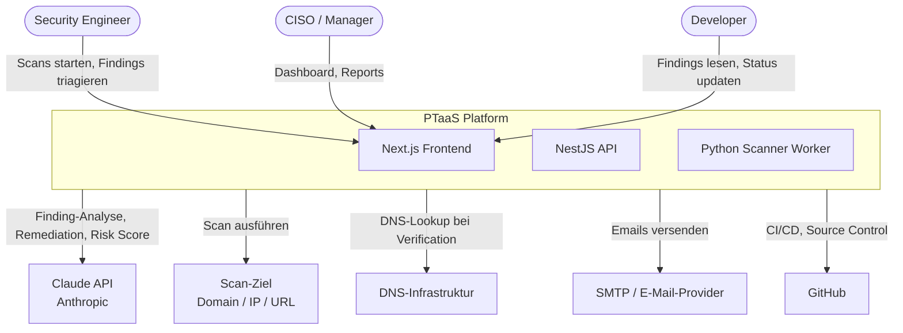
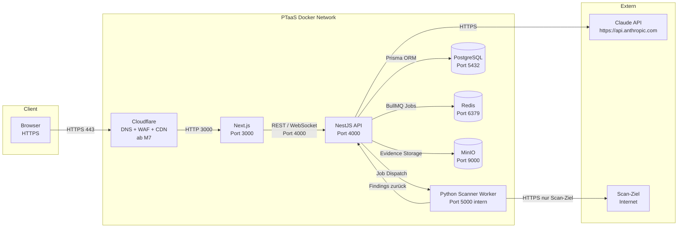
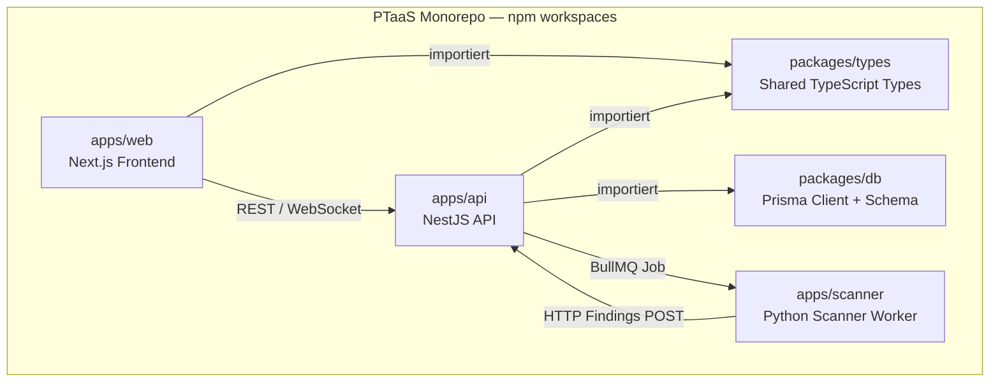
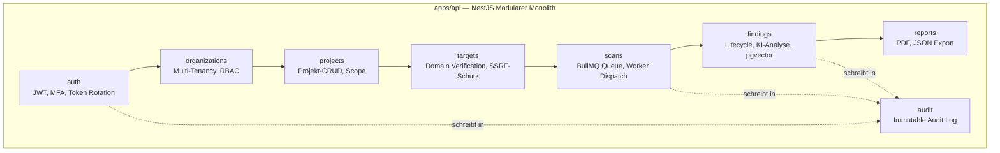
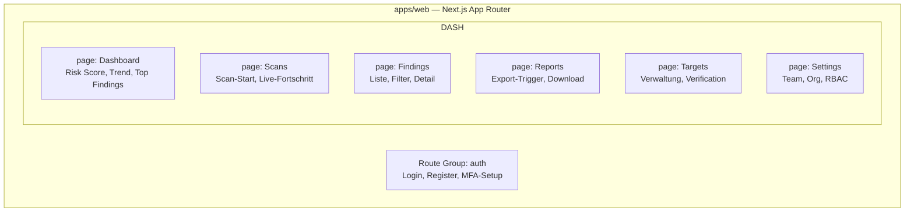
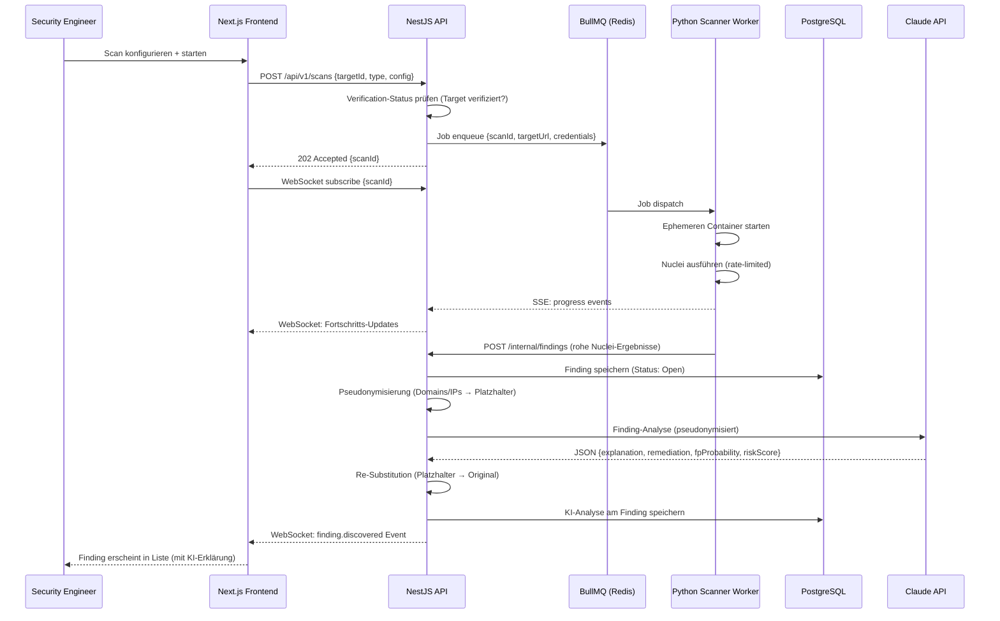
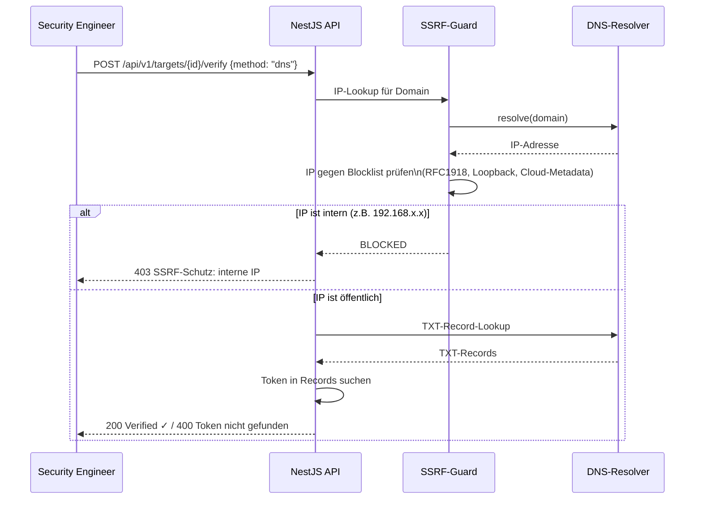
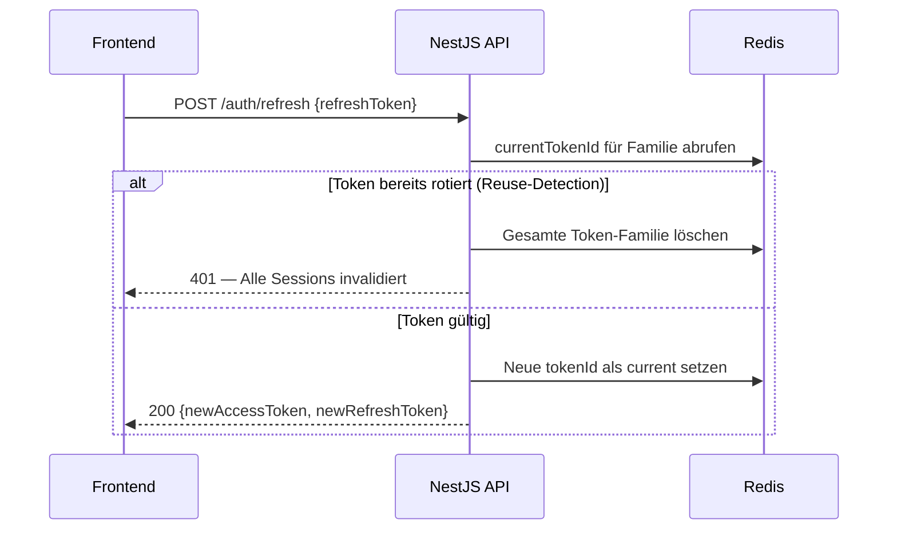
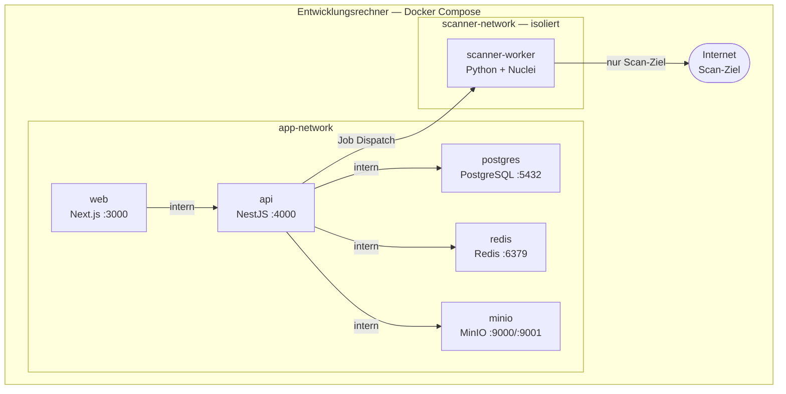
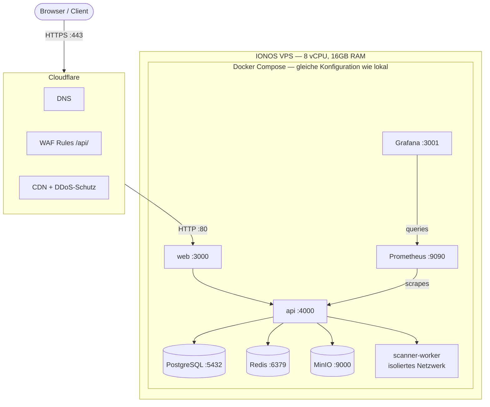

# arc42 Architecture Documentation — PTaaS Platform

**Version:** 1.0  
**Datum:** 2026-06-23  
**Status:** Living Document — wird mit jedem Milestone aktualisiert  
**Autor:** PTaaS Team  

---

## Inhaltsverzeichnis

1. [Einführung und Ziele](#1-einführung-und-ziele)
2. [Randbedingungen](#2-randbedingungen)
3. [Kontextabgrenzung](#3-kontextabgrenzung)
4. [Lösungsstrategie](#4-lösungsstrategie)
5. [Bausteinsicht](#5-bausteinsicht)
6. [Laufzeitsicht](#6-laufzeitsicht)
7. [Verteilungssicht](#7-verteilungssicht)
8. [Querschnittliche Konzepte](#8-querschnittliche-konzepte)
9. [Architekturentscheidungen](#9-architekturentscheidungen)
10. [Qualitätsanforderungen](#10-qualitätsanforderungen)
11. [Risiken und technische Schulden](#11-risiken-und-technische-schulden)
12. [Glossar](#12-glossar)

---

## 1. Einführung und Ziele

### 1.1 Aufgabenstellung

PTaaS (Penetration Testing as a Service) ist eine AI-native Security Operations & Pentest Automation Platform für KMUs und Mid-Market-Unternehmen ohne eigene Security-Abteilung.

Die Plattform vereint:
- Kontinuierliche Security Validation via automatisierten Scans
- AI-gestützte Schwachstellenanalyse und Priorisierung (Claude API)
- Rechtlich abgesichertes Scan-Framework mit Domain Verification
- Multi-Tenant Findings-Workflow mit vollständigem Audit Trail
- Compliance-taugliche Reports (Executive + Technical)

**Kernunterschied zu einfachen Vulnerability Scannern:** PTaaS ist ein Security Operating System — Findings werden nicht nur aufgelistet, sondern durch KI erklärt, priorisiert und mit konkreten Fix-Anleitungen versehen.

### 1.2 Qualitätsziele

| Priorität | Qualitätsziel | Motivation |
|-----------|--------------|------------|
| 1 | **Security** | Die Plattform scannt Fremdsysteme — sie selbst muss einem Angriff standhalten. Kompromittierung hätte fatale Folgen für Kundendaten. |
| 2 | **Zuverlässigkeit** | Scan-Jobs müssen auch bei Fehlern sicher abgeschlossen oder retry-fähig sein. Findings dürfen nicht verloren gehen. |
| 3 | **Datenschutz / Compliance** | DSGVO-Konformität und ISO 27001-Vorbereitung sind nicht optional — Kundendaten (Findings) sind hochsensibel. |
| 4 | **Wartbarkeit** | Solo-Entwickler-Kontext: Code muss von einer Person über 15+ Wochen wartbar sein. Klare Modul-Grenzen sind kritisch. |
| 5 | **Usability** | Developer ohne Security-Hintergrund müssen Findings verstehen und beheben können — ohne Rückfragen. |

### 1.3 Stakeholder

| Rolle | Erwartung |
|-------|-----------|
| **Security Engineer** | Scans schnell starten, Findings triagieren, Re-Scan nach Fix triggern |
| **CISO / Manager** | Risiko-Überblick in < 30 Sekunden, exportierbarer Executive Report |
| **Developer** | Finding mit KI-Erklärung und konkretem Fix-Guide — ohne Security-Wissen verstehbar |
| **Solo-Entwickler (Plattform-Owner)** | Wartbarer, gut dokumentierter Code; ISO-27001-Nachweisfähigkeit |
| **Zukünftige Kunden** | Nachweis der Scan-Autorisierung (Legal), Datenschutz bei API-Nutzung |

---

## 2. Randbedingungen

### 2.1 Technische Randbedingungen

| Randbedingung | Begründung |
|---------------|-----------|
| Docker Compose (kein Kubernetes) | Solo-Entwickler, kein Ops-Team; K8s erst Phase 3+ |
| npm workspaces Monorepo | Einfacher als Turborepo für kleine Teams; ausreichend für Phase 1 |
| PostgreSQL als Primary DB | pgvector-Anforderung für semantische Suche; SQL-Expertise vorhanden |
| IONOS VPS (kein AWS/GCP/Azure) | Kostenkontrolle: ~€25/Monat vs. mehrere hundert € in der Cloud |
| Lokal = Produktion (gleiche docker-compose.yml) | Keine Überraschungen beim Deployment; kein "works on my machine" |

### 2.2 Organisatorische Randbedingungen

| Randbedingung | Begründung |
|---------------|-----------|
| Solo-Entwickler | Architektur muss von einer Person überblickbar und wartbar sein |
| MVP-Zeithorizont 15 Wochen | Priorisierung auf lauffähige Features, kein Perfektionismus |
| Kein Budget für externe Services | Ausnahme: Claude API (~€10–30/Monat), IONOS VPS (~€25/Monat) |
| GitHub Actions CI/CD | Gratis bis 2.000 min/Monat; reicht für Phase 1 |

### 2.3 Konventionen und Compliance

| Randbedingung | Begründung |
|---------------|-----------|
| DSGVO-Konformität | Kundendaten (Findings) sind personenbezogene Daten; Plattform läuft in der EU |
| ISO 27001-Vorbereitung | Ziel: nachweisbares ISMS; kein formales Zertifikat in Phase 1 |
| Kein Scan ohne Domain Verification | Rechtliche Pflicht — kein Scan fremder Systeme ohne Autorisierungsnachweis |
| Argon2 für Passwort-Hashing | OWASP-Empfehlung; kein bcrypt/MD5/SHA1 |
| AVV mit Anthropic | Automatisch Bestandteil der Commercial Terms of Service; Datum der Akzeptanz intern dokumentieren |

---

## 3. Kontextabgrenzung

### 3.1 Business-Kontext



| Externer Akteur | Austausch |
|-----------------|-----------|
| Security Engineer | HTTPS: Scan-Konfiguration, Findings, Reports |
| CISO / Manager | HTTPS: Dashboard, Risk Score, Report-Export |
| Developer | HTTPS: Findings lesen, Status aktualisieren |
| Claude API (Anthropic) | HTTPS REST: Finding-Analyse, Remediation, Risk Score, Embeddings |
| Scan-Ziel | HTTP/HTTPS: Nuclei-Scans gegen Domain/IP/URL des Kunden |
| DNS-Infrastruktur | DNS: Domain Verification (TXT-Record-Lookup) |
| SMTP / E-Mail | SMTP: Einladungslinks, Notifications |
| GitHub | Git: Source Control, GitHub Actions CI/CD |

### 3.2 Technischer Kontext



---

## 4. Lösungsstrategie

### 4.1 Überblick

| Qualitätsziel | Lösungsansatz |
|--------------|--------------|
| **Security** | Argon2, JWT mit Rotation + Token Family Detection, MFA (TOTP), RBAC, Tenant Isolation, AES-256-GCM für Credentials, SSRF-Schutz, Scanner-Netzwerkirsolierung |
| **Zuverlässigkeit** | BullMQ mit Retry-Logik und Dead Letter Queue, ephemere Scanner-Container, Health-Checks auf allen Services |
| **Datenschutz** | Findings-Pseudonymisierung vor Claude API Call, DSGVO-Endpoints, Löschfristen-Cron, AVV mit Anthropic |
| **Wartbarkeit** | Modularer Monolith (NestJS), klare Domänen-Grenzen, Prisma als Single Source of Truth, Shared Types im `packages/types` |
| **Usability** | AI-First: jedes Finding hat Plain-Language-Erklärung + Fix-Guide; Persona-getrennte Views (Developer vs. Engineer) |

### 4.2 Architekturstil

**Modularer Monolith (Phase 1)** — NestJS mit klaren Domänen-Modulen:

- Vorteile: Solo-Entwickler, einfache Transaktionen, schnelle Iteration
- Modulgrenzen sind bereits die zukünftigen Microservice-Grenzen (Phase 3+)
- Python Scanner Worker bleibt bewusst separater Container (Security-Isolation + Python-Ökosystem)

### 4.3 Technologie-Entscheidungen

| Schicht | Technologie | Begründung |
|---------|------------|-----------|
| Frontend | Next.js 15+, TypeScript, Tailwind, shadcn/ui | App Router, Server Components, SSR; etabliertes React-Ökosystem |
| Backend | NestJS, TypeScript | Modularer Monolith, DI-Container, bewährte NestJS-Integration für BullMQ/Prisma |
| ORM | Prisma | Schema als Single Source of Truth, Migrations, Studio, pgvector-Support |
| Scanner | Python + Nuclei | 7.000+ Templates, Go-Binary, JSON-Output, aktiv maintained |
| Queue | BullMQ (Redis) | Redis sowieso vorhanden; Job-Persistenz, Retry-Logik, NestJS-Integration |
| KI | Claude API via Vercel AI SDK | Provider-agnostisch, strukturierter JSON-Output, beste Security-Analyse-Qualität |
| Embeddings | Voyage AI (`voyage-3`) | Anthropic-empfohlener Partner; Anthropic hat keine eigene Embedding-API |
| DB | PostgreSQL + pgvector | Transaktionale Daten + semantische Suche in einem Dienst |

---

## 5. Bausteinsicht

### 5.1 Ebene 1 — Gesamtsystem



| Baustein | Verantwortlichkeit |
|----------|-------------------|
| `apps/web` | UI, Server Components, Client Components, SSE-Streaming-Anzeige |
| `apps/api` | Business Logic, Auth, Queue-Management, KI-Integration, REST-API |
| `apps/scanner` | Nuclei-Orchestrierung, Evidence-Collection, Findings-Rückmeldung |
| `packages/types` | Geteilte TypeScript-Interfaces und Zod-Schemas (Frontend + Backend) |
| `packages/db` | Prisma-Client-Singleton, Schema, Migrations |

### 5.2 Ebene 2 — NestJS API Module



| Modul | Verantwortlichkeit | Milestone |
|-------|-------------------|-----------|
| `auth` | Registrierung, Login, MFA (TOTP), JWT (Access/Refresh), Token Rotation + Family Detection, Argon2 | M2 |
| `organizations` | Org-Struktur, RBAC (4 Rollen), Tenant-Isolation (alle Queries mit `org_id`) | M2 |
| `projects` | Projekt-CRUD, Scope-Definition | M3 |
| `targets` | Domain/IP/URL-Verwaltung, Verification (DNS/HTTP/Meta), SSRF-Schutz | M3 |
| `scans` | BullMQ Queue, Job-Dispatch, Fortschritts-Tracking, WebSocket/SSE | M4 |
| `findings` | Finding-Datenmodell, Lifecycle, Claude-API-Integration, Pseudonymisierung, pgvector-Embeddings | M5 |
| `reports` | PDF-Generierung (Executive + Technical), JSON-Export | M6 |
| `audit` | Immutable Audit Log (DB-Trigger), Compliance-Logging aller Events | M2 |

### 5.3 Ebene 2 — Next.js Frontend



---

## 6. Laufzeitsicht

### 6.1 Szenario: Erster Scan — Onboarding bis Finding



### 6.2 Szenario: Domain Verification (SSRF-Schutz)



### 6.3 Szenario: JWT Refresh Token Rotation



---

## 7. Verteilungssicht

### 7.1 Phase 1 — Lokale Entwicklung



**Wichtige Deployment-Entscheidungen:**
- Scanner-Worker läuft in isoliertem Docker-Netzwerk — kein Zugriff auf API, DB oder Redis
- Frischer ephemerer Container pro Scan (kein persistenter State)
- Scanner-Container läuft als non-root User (`USER scanner`)
- Secrets via Docker Secrets (kein `.env` im Container)

### 7.2 Phase 2 — Online Deployment (IONOS VPS, ab M7)



**Konfigurationsunterschiede lokal → online:**
- Nur `.env`-Variablen ändern sich (keine Architekturänderung)
- Cloudflare davor (DNS, SSL via Let's Encrypt, WAF)
- Prometheus + Grafana aktiviert (lokal deaktiviert)
- PostgreSQL-Backup-Cronjob (täglich nach MinIO, verschlüsselt)

---

## 8. Querschnittliche Konzepte

### 8.1 Authentifizierung & Autorisierung

- **Passwort-Hashing:** Argon2id — kein bcrypt, kein MD5/SHA1
- **MFA:** TOTP (RFC 6238) via Authenticator App — Pflicht, kein Bypass
- **JWT-Strategie:**
  - Access Token: 15 Minuten, im Memory gehalten
  - Refresh Token: 7 Tage, httpOnly Cookie, SameSite=Strict
- **Token Rotation + Family Detection:**
  - Bei jedem `/auth/refresh` wird der alte Token invalidiert
  - Redis führt `currentTokenId` pro Familie
  - Reuse-Detection → sofortige Invalidierung ALLER Sessions
- **RBAC:** 4 Rollen (Admin / Security Engineer / Developer / Viewer) via NestJS Guards
- **Tenant Isolation:** Alle DB-Queries enthalten `org_id` als Filter — kein Cross-Tenant-Datenleck

### 8.2 Audit Logging

- Alle sicherheitsrelevanten Events werden in `audit_logs` geschrieben
- **Immutability:** PostgreSQL-Trigger verhindert UPDATE/DELETE auf `audit_logs`
- Aufbewahrungsfrist: 36 Monate (kein Lösch-Cron für Audit Logs)
- Geloggte Events: Login, Logout, fehlgeschlagene Versuche, MFA-Setup, Passwortänderungen, Scan-Start/-Abschluss, Finding-Statusänderungen, Team-Änderungen, Report-Exports

### 8.3 Findings-Pseudonymisierung (DSGVO / ISO 27001)

Vor jedem Claude-API-Call wird der Finding-Payload pseudonymisiert:

```
Domains:     example.com   →  [DOMAIN-1]
IP-Adressen: 192.168.1.1   →  [IP-1]
Pfade/IDs:   /api/users/42 →  [PATH-1]
```

- Mapping-Tabelle nur im RAM (niemals persistiert)
- Re-Substitution nach Claude-Response, vor DB-Speicherung
- Kein PII verlässt die Plattform im Klartext

### 8.4 SSRF-Schutz

Bei jedem Verification-Request und Scan-Target:

1. Domain per DNS auflösen
2. Aufgelöste IP gegen Blocklist prüfen:
   - RFC1918: `10.0.0.0/8`, `172.16.0.0/12`, `192.168.0.0/16`
   - Loopback: `127.0.0.0/8`
   - Cloud-Metadata: `169.254.169.254/32`
3. IP-Range-Targets explizit gegen interne Ranges validieren
4. Erst nach erfolgreicher Prüfung: HTTP-Request absetzen

### 8.5 Fehlerbehandlung

- **NestJS:** Globaler Exception Filter — alle Fehler werden strukturiert geloggt (Pino) und als RFC 7807 Problem Detail zurückgegeben
- **BullMQ:** Automatischer Retry mit Exponential Backoff; nach 3 Versuchen in Dead Letter Queue
- **Claude API:** Circuit Breaker — bei API-Ausfall läuft Finding ohne KI-Analyse durch (kein Blocking); Retry-Queue für ausstehende Analysen
- **User-Enumeration-Schutz:** Login-Fehler nennen weder E-Mail noch Passwort explizit

### 8.6 Logging & Observability

- **Logging:** Pino (strukturiertes JSON) — identisch lokal und Produktion
- **Log-Level:** `info` in Produktion, `debug` lokal via `LOG_LEVEL` env
- **Metriken:** Prometheus (ab M7) — API-Latenz, Queue-Tiefe, Scan-Dauer, Finding-Count
- **Dashboards:** Grafana (ab M7) — Security-Operations-Dashboard
- **Health Checks:** `/health` auf allen Services (Liveness + Readiness)

### 8.7 Evidence Storage

- HTTP Requests/Responses, Payloads, Screenshots → MinIO (S3-kompatibel)
- **SSE aktiviert** (Server-Side Encryption)
- Immutable: kein Überschreiben von Evidence nach Speicherung
- Aufbewahrungsfrist: 12 Monate, danach Lösch-Cron (BullMQ Scheduled Job)

### 8.8 Scan-Credentials Verschlüsselung

- Basic Auth, Bearer Token, Cookies werden **nie im Klartext** in PostgreSQL gespeichert
- AES-256-GCM mit frischem IV pro Verschlüsselung
- AuthTag für Integritätsschutz
- DB-Format: `iv:authTag:ciphertext`
- Encryption Key (32 Bytes) ausschließlich als Docker Secret — nie in der DB
- Abruf nur durch Python Scanner Worker über internen, nicht-öffentlichen Endpoint

---

## 9. Architekturentscheidungen

### ADR-001 — Modularer Monolith vs. Microservices

| | |
|---|---|
| **Status** | Accepted — 2026-06-21 |
| **Entscheidung** | Modularer Monolith (NestJS) |
| **Kontext** | Solo-Entwickler, MVP-Zeithorizont, Anforderungen noch nicht vollständig stabil |
| **Begründung** | Microservices erfordern Team > 20, operative Reife und unabhängige Deployment-Zyklen — keines davon trifft zu. NestJS ist explizit für dieses Pattern gebaut. |
| **Abgelehnte Alternativen** | Microservices: 3–4× Ops-Overhead, verteilte Transaktionen / Einfacher Monolith: wird bei 8 Domänen zur "Big Ball of Mud" |
| **Konsequenzen** | Migration zu Microservices ab Phase 3 möglich — Modulgrenzen sind bereits die zukünftigen Service-Grenzen |

### ADR-002 — Scan Queue: BullMQ

| | |
|---|---|
| **Status** | Accepted — 2026-06-21 |
| **Entscheidung** | BullMQ mit `concurrency: 1` (sequentielles Scanning) |
| **Kontext** | Kein paralleles Scanning geplant; Redis sowieso im Stack |
| **Begründung** | BullMQ fügt null extra Infrastruktur hinzu; beste NestJS-Integration; Job-Persistenz + Retry-Logik out-of-the-box |
| **Abgelehnte Alternativen** | NATS JetStream: eigener Dienst, kein nativer NestJS-Support / RabbitMQ: eigener Dienst, overkill / pg-boss: kein Vorteil da Redis eh vorhanden |
| **Konsequenzen** | Kein paralleles Scanning in Phase 1 (bewusste Einschränkung) |

### ADR-003 — ORM: Prisma

| | |
|---|---|
| **Status** | Accepted — 2026-06-21 |
| **Entscheidung** | Prisma |
| **Kontext** | Typsicherer Datenbankzugriff mit Migrations und pgvector-Support |
| **Begründung** | Beste DX im Node.js-Ökosystem, Schema als Single Source of Truth, Prisma Studio, bewährte NestJS-Integration |
| **Abgelehnte Alternativen** | Drizzle: jünger, Migrations-Tooling nicht ausgereift, kein Studio / Raw SQL: kein Typsystem, fehleranfällig |

### ADR-004 — Scanner: Nuclei

| | |
|---|---|
| **Status** | Accepted — 2026-06-21 |
| **Entscheidung** | Nuclei (ProjectDiscovery) |
| **Kontext** | Template-basiertes Scanning mit Community-Template-Ökosystem |
| **Begründung** | 7.000+ Templates (CVEs, Misconfigs, Exposures), leichtgewichtiges Go-Binary, JSON-Output, aktiv maintained, neue CVE-Templates oft innerhalb von Stunden |
| **Abgelehnte Alternativen** | OWASP ZAP: Java-basiert (schweres Image), komplexere API, langsamer Start; ZAP kommt als Ergänzung in Phase 2 |

### ADR-005 — KI: Claude API via Vercel AI SDK

| | |
|---|---|
| **Status** | Accepted — 2026-06-21 |
| **Entscheidung** | Anthropic Claude API via Vercel AI SDK (`claude-sonnet-4-6` für Analyse, `claude-haiku-4-5` für Bulk-Tasks) |
| **Kontext** | AI-native Plattform — Finding-Analyse, Remediation, Risk Scoring, False-Positive-Detection |
| **Begründung** | State-of-the-art Reasoning-Qualität für Security-Analyse, zuverlässiger strukturierter JSON-Output, provider-agnostisch durch Vercel AI SDK |
| **Abgelehnte Alternativen** | Ollama: deutlich schlechtere Qualität, GPU-Hardware nötig / Hybrid Ollama+Claude: unterschiedlicher Output in verschiedenen Umgebungen |
| **Datenschutz-Hinweis** | Findings werden vor API-Call pseudonymisiert; AVV = Bestandteil der Anthropic Commercial ToS |

### ADR-006 — Scanner Worker Isolation

| | |
|---|---|
| **Status** | Accepted — 2026-06-21 |
| **Entscheidung** | Docker Network Policy + ephemerer Container pro Scan |
| **Kontext** | Scanner führt unbekannten Code (Nuclei-Templates) gegen fremde Systeme aus |
| **Begründung** | Zwei Maßnahmen kombiniert: (1) isoliertes Docker-Netzwerk, nur Scan-Ziel erreichbar; (2) frischer Container pro Scan, kein persistenter State |
| **Abgelehnte Alternativen** | gVisor: Phase 2+ (komplexes Setup, ~20% Performance-Overhead) / Firecracker: Phase 3+ (MicroVMs, erheblicher Infrastruktur-Aufwand) |
| **Konsequenzen** | Container-Startup-Zeit pro Scan: ~2–5s Overhead (akzeptabel) |

---

## 10. Qualitätsanforderungen

### 10.1 Qualitätsbaum

```
PTaaS Qualitätsanforderungen
├── Security
│   ├── Authentifizierung (MFA, JWT Rotation)
│   ├── Autorisierung (RBAC, Tenant Isolation)
│   ├── Scan-Isolation (Docker Network, ephemere Container)
│   └── Datenschutz (Pseudonymisierung, AES-256-GCM)
├── Zuverlässigkeit
│   ├── Scan-Job-Persistenz (BullMQ Retry)
│   ├── Finding-Integrität (keine Datenverluste)
│   └── Service-Verfügbarkeit (Health Checks)
├── Performance
│   ├── Dashboard Response Time (< 500ms)
│   └── Scan-Start-Latenz (< 30s)
├── Wartbarkeit
│   ├── Modulare Architektur (klare Domänen)
│   ├── Typsicherheit (TypeScript end-to-end)
│   └── Testbarkeit (Vitest Unit, Playwright E2E)
└── Usability
    ├── Time-to-First-Finding (< 10 Minuten)
    └── Finding-Verständlichkeit (KI-Erklärung)
```

### 10.2 Qualitätsszenarien

| ID | Qualitätsziel | Szenario | Messgröße |
|----|--------------|---------|-----------|
| QS-01 | Security | Ein Angreifer verwendet einen gestohlenen Refresh Token nach bereits erfolgter Rotation | Alle Sessions des Nutzers werden sofort invalidiert; Angriff schlägt fehl |
| QS-02 | Security | Ein Scanner-Container wird durch einen kompromittierten Nuclei-Template angegriffen | Container hat keinen Zugriff auf API, DB oder Redis; stirbt nach Scan-Ende |
| QS-03 | Datenschutz | Ein Finding mit Kundendomain wird zur KI-Analyse gesendet | Domain erscheint im Claude-API-Payload nur als `[DOMAIN-1]` |
| QS-04 | Performance | Ein User öffnet das Dashboard nach einem Scan mit 200 Findings | Response Time < 500ms (p95) |
| QS-05 | Zuverlässigkeit | Die BullMQ Queue verliert die Verbindung zu Redis während eines Scans | Job wird nach Reconnect automatisch fortgesetzt; kein Finding geht verloren |
| QS-06 | Usability | Ein Developer ohne Security-Hintergrund öffnet ein Critical Finding | Versteht Problem und Fix-Schritte ohne externe Recherche |
| QS-07 | Security | Verification-Request gegen `192.168.1.1` wird gestellt | Request wird durch SSRF-Guard geblockt; kein HTTP-Request an interne IP |

---

## 11. Risiken und technische Schulden

| ID | Risiko / Schuld | Wahrscheinlichkeit | Impact | Mitigation |
|----|-----------------|-------------------|--------|-----------|
| R-01 | **Over-Velocity Sprint 2/3** — S2 hat 44 SP, S3 hat 42 SP bei 28 SP-Velocity | Hoch | Mittel | Scope-Cut: Audit-Log-Lese-UI von S2 auf S3 verschieben; Domain Verification ggf. auf S4 |
| R-02 | **Solo-Entwickler-Risiko** — Krankheit/Ausfall stoppt alle Entwicklung | Mittel | Hoch | Gute Dokumentation (diese arc42-Docs), CLAUDE.md-Kontext für AI-Assistenz |
| R-03 | **Docker-Netzwerk-Konfiguration** — Inter-Service-Kommunikation kann komplex sein | Mittel | Mittel | Früh in M1 testen; Health-Checks auf allen Services |
| R-04 | **Claude API Abhängigkeit** — Anthropic ändert Pricing oder API | Niedrig | Mittel | Vercel AI SDK ist provider-agnostisch; Wechsel zu GPT-4o ohne Architekturänderung möglich |
| R-05 | **gVisor-Migration offen** — Scanner läuft ohne Kernel-Level-Sandboxing | Mittel | Hoch | Für Produktion mit echten Kunden evaluieren (Phase 2); Docker Network Isolation als Übergangslösung |
| R-06 | **ISO 27001 ISMS-Dokumente ausstehend** — SECURITY_POLICY, RISK_REGISTER etc. noch nicht erstellt | Hoch | Mittel | Können parallel zur Entwicklung erstellt werden; kein Code-Blocker |
| R-07 | **AVV-Vorlage für Kunden fehlt** — Scan fremder Systeme ohne Kundenvertrag nicht zulässig | Niedrig (Phase 1) | Hoch | Muss vor erstem echten Kunden erstellt werden; kein Blocker für interne Tests |
| R-08 | **pgvector-Performance bei Scale** — Embedding-Suche bei >10.000 Findings ungetestet | Niedrig | Niedrig | HNSW-Index für pgvector; bei Bedarf Partitionierung in Phase 2 |

---

## 12. Glossar

| Begriff | Definition |
|---------|-----------|
| **ADR** | Architecture Decision Record — dokumentierte Architekturentscheidung mit Kontext, Entscheidung und Konsequenzen |
| **AES-256-GCM** | Advanced Encryption Standard mit 256-Bit-Key im Galois/Counter-Mode; bietet Verschlüsselung + Integritätsschutz (AuthTag) |
| **Argon2** | Modernes Passwort-Hashing-Verfahren (Gewinner Password Hashing Competition 2015); OWASP-empfohlen |
| **Attack Surface** | Gesamtheit aller angreifbaren Einstiegspunkte eines Systems |
| **AVV** | Auftragsverarbeitungsvertrag — DSGVO-Pflichtvertrag bei Übermittlung personenbezogener Daten an Dritte |
| **BullMQ** | Redis-basierte Job-Queue-Bibliothek für Node.js mit Retry-Logik, Dead Letter Queue und NestJS-Integration |
| **CVSS** | Common Vulnerability Scoring System — standardisiertes Bewertungssystem für Schwachstellen (Score 0–10) |
| **CWE** | Common Weakness Enumeration — Katalog von Software-Schwachstellentypen |
| **Dead Letter Queue** | Queue für fehlgeschlagene Jobs nach Überschreiten der maximalen Retry-Anzahl |
| **DSGVO** | Datenschutz-Grundverordnung — EU-Datenschutzrecht (= GDPR) |
| **Ephemerer Container** | Docker-Container der nach Aufgabenabschluss automatisch gelöscht wird; kein persistenter State |
| **False Positive** | Schwachstellenmeldung die in Wirklichkeit keine Schwachstelle darstellt |
| **Finding** | Einzelner Schwachstellenfund aus einem Scan mit Severity, CVSS, CWE, Beweis-Evidence und KI-Analyse |
| **HNSW** | Hierarchical Navigable Small World — Indexstruktur für effiziente Vektorsuche in pgvector |
| **httpOnly Cookie** | Cookie das nur vom Server gelesen werden kann; nicht via JavaScript zugreifbar; schützt vor XSS |
| **ISO 27001** | Internationaler Standard für Information Security Management Systems (ISMS) |
| **IV** | Initialization Vector — einmalig generierter Zufallswert für symmetrische Verschlüsselung (AES-GCM) |
| **JWT** | JSON Web Token — selbstenthaltendes Token-Format für Authentifizierung |
| **KMU** | Kleine und mittlere Unternehmen |
| **MinIO** | S3-kompatibler Object Storage für Self-Hosting |
| **Modularer Monolith** | Einzelner deployable Service mit klaren Modul-Grenzen; Kompromiss zwischen Monolith und Microservices |
| **MFA / TOTP** | Multi-Factor Authentication / Time-based One-Time Password — zweiter Faktor via Authenticator App |
| **Nuclei** | Open-Source-Scanner mit YAML-basierten Templates für CVEs, Misconfigurations, Exposures |
| **OWASP Top 10** | Jährlich aktualisierte Liste der 10 kritischsten Web-Schwachstellenkategorien |
| **pgvector** | PostgreSQL-Extension für Vektoroperationen (Embeddings, semantische Suche) |
| **Pino** | Schnelles, strukturiertes JSON-Logging für Node.js |
| **PTaaS** | Penetration Testing as a Service |
| **RBAC** | Role-Based Access Control — Zugriffskontrolle basierend auf Benutzerrollen |
| **RFC1918** | Standard der private IP-Adressräume definiert (10.x, 172.16.x, 192.168.x) |
| **SameSite=Strict** | Cookie-Attribut das Cross-Site-Request-Forgery (CSRF) verhindert |
| **SCCs** | Standard Contractual Clauses — EU-Standardvertragsklauseln für Datentransfer in Drittländer |
| **Severity** | Schweregrad einer Schwachstelle: Critical / High / Medium / Low / Info |
| **SSRF** | Server-Side Request Forgery — Angriff bei dem ein Server dazu gebracht wird, interne Ressourcen abzufragen |
| **Tenant / Multi-Tenancy** | Mehrere Organisationen nutzen dieselbe Plattform mit strikter Datentrennung |
| **Token Family Detection** | Mechanismus zur Erkennung von gestohlenen Refresh Tokens via Family-ID in Redis |
| **Vercel AI SDK** | Provider-agnostisches TypeScript SDK für LLM-Integration (unterstützt Claude, GPT-4, Gemini) |
| **Voyage AI** | Embedding-Anbieter (Anthropic-Partner) für semantische Vektorisierung von Texten |
| **WAF** | Web Application Firewall — filtert böswilligen HTTP-Traffic |
| **Zero Data Retention** | Anthropic-Option bei der API-Inputs/-Outputs nicht für Training gespeichert werden |

---

*Dokument erstellt: 2026-06-23 · PTaaS arc42 Architecture Documentation v1.0*  
*Nächste Aktualisierung: nach M1-Abschluss (Monorepo-Struktur, Docker-Compose, tatsächliche Modul-Aufteilung)*
